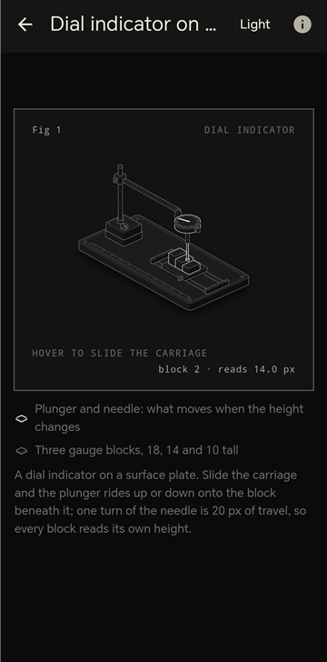
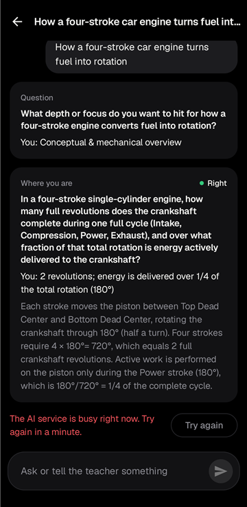
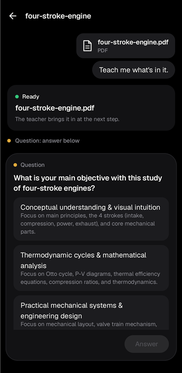
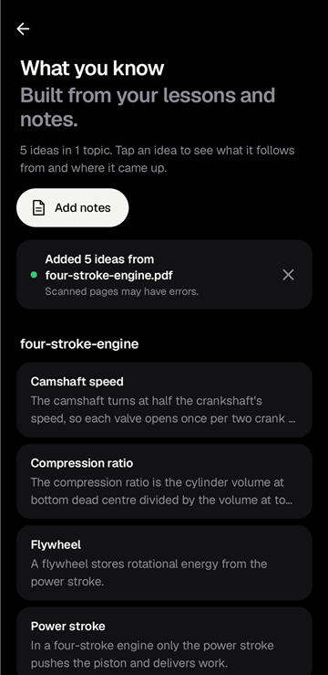
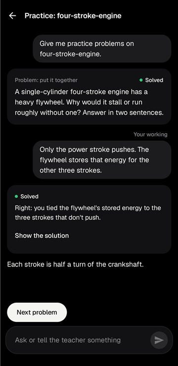

# VisualLearn

**An Android learning app that teaches from your own material, and builds interactive 3D figures for the things you need to see moving.**

Give it a question or a PDF of lecture notes. VisualLearn works out what you already know, plans the shortest path to your goal, and teaches one step at a time with a graded check after each step. When a mechanism is easier to understand by watching it, such as an engine cycle, a lock or a measuring gauge, the server has an AI agent build a working 3D figure you can turn and play with.


| 3D figure | Lesson with a graded check | Learning from a PDF | What you know | Practice |
|:---:|:---:|:---:|:---:|:---:|
|  |  |  |  |  |

## Features

- **Lessons that start from what you know.** A lesson first asks a few probing questions, then plans the steps to your goal and teaches them one at a time. Each step ends with a check: multiple choice, a prediction, or an answer in your own words, graded with an explanation.
- **Learn from a PDF.** Attach lecture notes, a chapter or a paper. The teacher reads it in the background and builds the lesson on it.
- **3D figures built on demand.** An AI agent writes a self-contained interactive figure with [Anatomy](https://github.com/wheresryan22/anatomy). Figures render in a sandboxed WebView with no network access, in dark and light versions.
- **What you know.** Every idea you meet is kept as one plain statement, grouped by topic, with what it follows from and the lessons it came up in. You can add your own notes too.
- **Practice.** Problems on a topic, one at a time: you write your working, get a verdict, and then see the full solution.
- **Quick answers in chat,** with Markdown, interactive quizzes, flashcards and step-by-step explainers.
- **Works offline.** Lessons, chats and figures you've opened stay readable without a connection.
- **Any model provider.** An admin routes work to Anthropic, OpenAI or Google models, or to a self-hosted OpenAI-compatible server such as vLLM or Ollama.

## Engineering highlights

- **A process per learner.** The lesson engine, [LearnHarness](https://github.com/amosblomqvist/learnharness), was designed for one person on a desktop. The server turns it into a multi-user service. Each learner gets their own process, on demand, with:
  - their own data folder and file sandbox;
  - only the environment variables they need;
  - a random per-launch secret, so nothing else on the machine can reach their lessons.

  Idle processes are stopped, there is a cap on how many run at once, and only learner routes are forwarded to the process.
- **Long-running agent jobs.** A figure can take 20 to 60 minutes. Jobs wait in a round-robin queue that is fair across users and run as isolated [OpenCode](https://opencode.ai) agents. Progress streams to the phone live. A retry resumes the saved session, and jobs cut off by a restart go back into the queue.
- **Untrusted content stays contained.** The phone blocks every network request from model-generated figures and demos. Pages are stored and served by content hash through short-lived signed links, and the app checks each page's sha256 before caching it.
- **Resilient streaming and offline sync.** Chat streams over Server-Sent Events and picks up where it left off after a dropped connection. A sync cursor brings in changes and deletions made elsewhere. Signing out wipes the phone's copy.
- **Model-agnostic.** The admin chooses which model handles each kind of work, and keys never touch disk. A [checking script](server/scripts/check-models.ts) tells you whether a self-hosted model can run lessons. It tests tool calling, structured arguments, long context and image input.
- **Tested.** The server has 80 tests (`node:test`) covering auth, scheduling, sync, PDF handling and the per-learner gateway, the last against a fake harness. The app has unit tests for lesson parsing, answer grading and math rendering.

## Architecture

```
 Android app (app/)                      VisualLearn server (server/)
 ┌──────────────────────────┐  HTTPS    ┌──────────────────────────────────────┐
 │ Jetpack Compose UI       │  REST +   │ Fastify API: auth, chat, sync, admin │
 │ Chat, Lessons, Figures   │  SSE      │                                      │
 │ Offline store + sync     ├──────────►│ /v1/learn ─► one LearnHarness process│
 │ Sandboxed WebViews       │           │              per learner (127.0.0.1) │
 │ (figures, demos, quizzes)│◄──────────┤ Figure queue ─► OpenCode + Anatomy   │
 └──────────────────────────┘  signed   │ SQLite, content-addressed pages      │
                               page URLs│ Model routing: cloud or local models │
                                        └──────────────────────────────────────┘
```

| Part | Stack |
|---|---|
| Android app | Kotlin 2.4, Jetpack Compose, Material 3, coroutines and Flow, OkHttp, Coil, WorkManager, Android Keystore |
| Server | Node 24 running TypeScript directly, Fastify 5, `node:sqlite`, Vercel AI SDK, headless Chromium for previews |
| Lesson engine | LearnHarness fork (Next.js 16, pi-agent-core), run as a standalone server |
| Figures | OpenCode agents with the Anatomy skill |
| Interactive parts | OpenUI component library (React) bundled into the app |

## Repository layout

```
app/          Android app: ui/, learn/ (lessons, practice, knowledge), chat/, figures/, offline/, api/
server/       API server, figure queue and LearnHarness gateway (see server/README.md)
harness/      LearnHarness fork, the lesson engine (see harness/UPSTREAM.md for the changes)
ui-library/   OpenUI components for interactive chat parts
docs/         API contract, development guide, screenshots
```

## Running it

The quickest way to see the app is a debug build, which falls back to a built-in fake server. Sign in with any email and the code `123456`:

```sh
./gradlew installDebug
```

To use the real server with lessons, run it locally and point the emulator at it:

```sh
cd server && npm install && VL_DEV_AUTH=1 npm start
./gradlew installDebug -Pvisuallearn.apiBaseUrl=http://localhost:8080/v1   # after: adb reverse tcp:8080 tcp:8080
```

Full instructions are in [docs/development.md](docs/development.md) (app) and [server/README.md](server/README.md) (server, model setup, deployment).

## Status

Working end to end:
- sign-in, chat with study packs, and 3D figure jobs (tested on an emulator and a physical phone);
- lessons, including lessons started from a PDF (emulator);
- What you know with notes import (emulator);
- practice sessions (emulator);
- offline reading (emulator).

Not done yet:
- push notifications;
- email delivery of sign-in codes in production;
- a first build of the Docker image;
- a production deployment.

Real lessons and figures need a paid model key or self-hosted models: a free Gemini key allows about 20 requests a day per model, which is too few.

## Licence and credits

The lesson engine in [harness/](harness/) is a fork of [LearnHarness](https://github.com/amosblomqvist/learnharness) by Amos Blomqvist, licensed under the GNU AGPL-3.0. Anyone using a VisualLearn server is entitled to its source, changes included; the plan is to license the server as AGPL-3.0 too.

Figures are built with [Anatomy](https://github.com/wheresryan22/anatomy) (MIT). Gallery figures come from the Anatomy community and are credited to their authors. Third-party notices are in [app/src/main/assets/licenses.md](app/src/main/assets/licenses.md) and in the app under Settings → Open-source licences.

## Team

- Abdulaziz Taju ([GitHub](https://github.com/AbdulazizTajuMohammedyasin))
- Mohammedsaad
- Usman Anyalo
